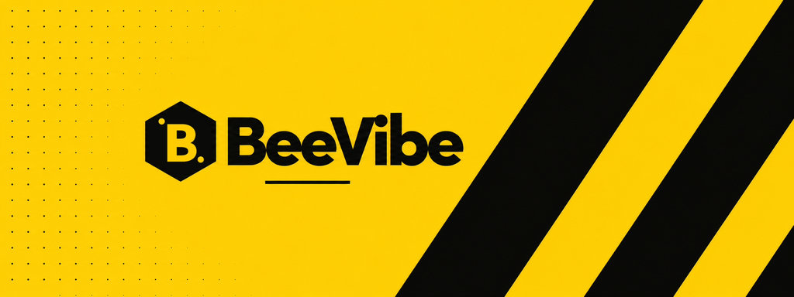

# BeeVibe



**A playable game from one sentence.** Describe an idea in a sentence — a pipeline of
LLM agents turns it into a self-contained HTML5 game you can play in the browser,
patch with words, rate and publish to a catalog.

Built as the Beeline case solution for the **ITSprint 2026** hackathon.

```
"a neon snake in a cyberpunk city, the tempo grows with the tail"  ->  /g/neon-snake  ->  play
```

## What it does

- **Generate** — prompt plus optional title, description, genre, style, tempo and map
  size produce a spec, a plan, code and assets, assembled into one HTML file.
- **Watch it build** — live progress over SSE: stage timeline, artifacts, terminal log,
  refund-aware errors.
- **Iterate** — patch with plain language, tune tempo/map/difficulty/palette, repair a
  broken build, roll back to any version.
- **Name it** — title and description can be set at creation or edited at any time;
  a paid action lets the model invent the name, description and cover from the build.
- **Publish** — a public page with a sandboxed iframe, a shareable link, a download
  button and a 1–5 rating.
- **Catalog** — search, genre filters, sorting by freshness, rating or playtime, plus
  time-played tracking.
- **Tokens** — signup grant, per-action prices, demo top-up with a daily cap, full
  operation history. A failed build is refunded.

## How the pipeline works

Seven agent stages run in a worker pool; every stage writes an artifact to Postgres, so
a rerun can resume from where it stopped instead of paying for the whole pass again.

Two speed modes are available at creation time (`speed` in the request):

| Mode | Calls | Pipeline | Price |
| --- | --- | --- | --- |
| `normal` | 7 | analyze → plan → code → assets → review → assemble → check | full |
| `fast` | 2 | spec+plan → the whole game as one HTML document → check | −25% |

The fast mode keeps the same status vocabulary (`analyzing`, `coding`, `checking`) as a
subsequence of the full pipeline, so resume, retry and the progress UI work in both modes.
It has no review stage, one repair attempt and its own LLM client (`fast.llm`), and it
streams the big generation call so a provider gateway does not cut it off.

```
prompt
  |
  v
[1] analyze  -> genre, mechanics, constraints
[2] plan     -> rules, win/lose conditions, structure
[3] code     -> the game itself
[4] assets   -> palette, visual language
[5] review   -> runs the HTML, compares it with the plan
      |            \
      |             `-> needs_decision: the author either accepts the code
      |                 or asks for the code stage only
[6] assemble -> one self-contained HTML document
[7] check    -> final validation (self-contained, JS syntax)
  |
  v
version ready -> playable at /g/<slug>
```

In the fast mode the same path is compressed to two calls:

```
prompt
  |
  v
[1] spec+plan  -> spec JSON and the plan in one answer
[2] one-shot   -> the whole self-contained game in one streamed HTML answer
  |
  v
check -> version ready
```

Failure at any stage marks the game `failed`; the author can repair it with a hint or
retry from the failed stage. Editing operations (patch, config, repair, rollback)
produce new versions on top of the same game, so the owner always keeps the history;
naming (`PATCH /meta`) only touches the card.

## Architecture

```
                    browser
        +--------------+---------------+
        |                              |
   Vue 3 SPA                     sandboxed iframe
   (Vite, Pinia, Tailwind)       (generated /g/<slug>)
        |                              ^
        | REST + SSE, session cookie   |
        v                              |
+--------------------+                 |
|  Go service        |  serves the SPA |
|  chi router        |  from http.static_dir
|  usecase / adapter |
+---------+----------+
          |                    |
          v                    v
     PostgreSQL            Kafka topic game.events
   (games, versions,       (outbox -> consumer ->
    artifacts, tokens,      game_event_log projection)
    ratings, sessions)
          |
          v
    LLM provider (OpenRouter or any OpenAI-compatible server)
```

- **Backend** — layered Go service (`domain -> dto -> usecase -> adapter/controller`),
  transactions wrapped explicitly, outbox for Kafka, ids and slugs carried in the API.
- **Frontend** — Vue 3 SPA with a custom cream/near-black theme, SSE workspace,
  sandboxed playable iframe, ratings and catalog.
- **One image** serves both: the Go binary serves the built SPA (`http.static_dir`) and
  the API on the same origin, so cookies, SSE and iframes need no CORS setup.

## Stack

| Layer      | Technology                                                                 |
| ---------- | -------------------------------------------------------------------------- |
| Backend    | Go 1.27, chi v5, pgx v5, segmentio/kafka-go, zerolog, go-playground/validator, goose migrations |
| Database   | PostgreSQL 18 (games, versions, artifacts, events, outbox, tokens, ratings) |
| Messaging  | Kafka (KRaft) with an outbox table and an event-log projection             |
| LLM        | OpenRouter or any OpenAI-compatible endpoint (llama.cpp, vLLM); reasoning effort per stage |
| Frontend   | Vue 3 + TypeScript, Vite 8, Pinia, Vue Router 5, OpenVue (PrimeVue 4 fork), Tailwind CSS 4, Bun |
| Deployment | Multi-stage Docker image (Bun build + Go build + Alpine runtime with goose), Docker Compose stack |
| CI         | GitHub Actions: gofmt/vet/golangci-lint/tests for the backend, oxfmt/oxlint/ESLint for the frontend |

## Repository layout

```
backend/               Go service
  cmd/app              entrypoint
  internal/domain      entities, invariants, status machine
  internal/usecase     operations, ports, worker pool, pipeline
  internal/adapter     postgres, kafka, auth (bcrypt), validator
  internal/controller  http v1 + public pages + kafka consumer
  internal/dto         request/response shapes
  api/http/openapi.yaml  the contract the frontend and READMEs follow
  migrations/          goose migrations
  configs/             config.example.yaml (committed), config.yaml (local)
  pkg/                 httpserver, static (SPA), llm client, render, logger,
                       transaction, tracer, postgres
frontend/              Vue 3 SPA
  src/pages            generator, catalog, workspace, play, auth, profile
  src/components       layout, catalog, game frame, generator preview
  src/stores           auth, catalog, game (SSE lifecycle), theme
  src/api              typed client, SSE wrapper, generated schema
deploy/                container config template and sync script
docker-compose.yml     app + Postgres + Kafka + migrations stack
docker-compose.dev.yaml  local infrastructure for development
Dockerfile             single image with the SPA and the API
```

## Getting started

### Option 1 — the container stack

Requirements: Docker with Compose. The stack runs the published
`ghcr.io/tolyanl/beevibe:latest` image, so no local Go/Bun toolchain is needed.

```sh
cp deploy/config.example.yaml deploy/config.yaml   # once, then fill llm.api_key
#    or keep one source of truth with the local dev config:
./deploy/sync-config.sh

docker compose up -d --wait     # app + Postgres + Kafka + migrations
```

The app lands on `http://localhost:8080`: the SPA at `/`, the API under `/api`,
generated games at `/g/<slug>`. Migrations run as a one-shot service before the app
starts (`goose` is inside the image), and Kafka creates `game.events` on the first write
(`KAFKA_NUM_PARTITIONS: 8`), so no topic-init container is needed. `APP_PORT=8081` moves
the published port, `--build` builds from the working tree instead of pulling the image,
`IMAGE=ghcr.io/tolyanl/beevibe:v1.4.1` pins a release, and `--wait` blocks until the
app healthcheck passes.

`deploy/config.yaml` is mounted read-only over `/app/configs/config.yaml` — the path the
image bakes into `APP_CONFIG_PATH` — and is gitignored because it holds the LLM key. It
has to exist **before** `docker compose up`: Docker bind-mounts a directory for a missing
path, so the app checks the file and exits with `deploy/config.yaml is missing: run
./deploy/sync-config.sh` instead of a cryptic `is a directory`. The file is read once at
startup, so recreate the container after editing it.

`./deploy/sync-config.sh` copies `backend/configs/config.yaml` and rewrites what cannot
work inside the compose network — the Postgres and Kafka hosts, console logs to JSON, a
model on the host through `host.docker.internal` (the compose file already sets
`extra_hosts`). For a model behind an API the key is the only thing to fill in; every LLM
field is described under Option 2.

To recreate just the app container — on a stack made by `docker compose up -d db kafka
migrate`, with `app` stopped, otherwise port 8080 is taken:

```sh
docker run -d --name beevibe_app --network beevibe_default -p 8080:8080 \
  -v "$PWD/deploy/config.yaml:/app/configs/config.yaml:ro" \
  ghcr.io/tolyanl/beevibe:v1.4.1

curl -s localhost:8080/api/health    # {"status":"ok","version":"1.4.1"}
```

`$PWD` must be the repository root; use an absolute path otherwise, and add
`--add-host host.docker.internal:host-gateway` for a model on the host. Trust
`/api/health`, not `/`: the SPA answers 200 even with a dead database. The usual
failures: `network beevibe_default not found` — the compose stack is not up;
`pool.Ping: … lookup db` — no `--network beevibe_default`, or the config still points at
hosts that only exist outside the network; `port is already allocated` — another
container publishes 8080.

### Option 2 — local development

Requirements: Go 1.27, Bun, Docker (for Postgres and Kafka only).

```sh
# infrastructure: Postgres + Kafka + Kafka UI
docker compose -f docker-compose.dev.yaml up -d

cd backend
make config          # creates configs/config.yaml from the example
make migrate-up      # goose migrations
make run             # the service on :8080

cd ../frontend
bun install
bun run dev          # SPA on :5173, proxying /api and /g to :8080
```

Fill `llm.api_key` in `backend/configs/config.yaml` to generate games. Any
OpenAI-compatible endpoint works:

```yaml
llm:
  api_key: "sk-or-..."                     # or any string for a local server
  model: deepseek/deepseek-v4.1-flash-1017 # e.g. a local qwen build
  base_url: https://openrouter.ai/api/v1   # e.g. http://127.0.0.1:12286/v1
  reasoning_dialect: openrouter            # or "openai" for llama.cpp / vLLM
```

`llm.timeout` has to outlive the model's thinking, which runs for minutes before the
first content token: `600s` is enough for an API, a local model needs `3600s`.
`max_tokens: 0` leaves the output uncapped — a tighter limit returns an empty answer
with `finish_reason: length`.

## Configuration

`backend/configs/config.yaml` (`APP_CONFIG_PATH` overrides the path). Missing fields fall
back to defaults in `internal/config`; a mandatory parameter is validated on startup.

| Section          | What lives there                                                                 |
| ---------------- | -------------------------------------------------------------------------------- |
| `app`            | name and version reported by `/api/health`                                       |
| `http`           | port, timeouts (`write_timeout: 0s` keeps SSE open), `static_dir` for the SPA     |
| `postgres`       | DSN and pool settings                                                            |
| `llm`            | provider, model, timeout/max_tokens/retries, reasoning dialect, debug dump directory |
| `llm_reasoning`  | effort per stage: `default`, `none`, `minimal`, `low`, `medium`, `high`, `xhigh`, `max` |
| `tokens`         | signup grant, prices (generate/patch/meta), demo top-up limits                   |
| `worker`         | concurrency, per-game timeout, call budget, repair attempts                      |
| `kafka`          | brokers, topic (`game.events`), consumer group                                   |
| `auth`           | bcrypt cost                                                                      |
| `validator`      | optional Node path for the generated-JS syntax check                             |

Tokens: a new account gets `tokens.grant_signup` (1,000,000 by default), a full build
costs `price_generate` (320,000), a patch 40,000, model-written meta 10,000. Demo top-up
is limited per request and per day.

## API

The machine-readable contract is [`backend/api/http/openapi.yaml`](backend/api/http/openapi.yaml);
the endpoint-by-endpoint reference with examples is [`backend/README.md`](backend/README.md).
The frontend is documented in [`frontend/README.md`](frontend/README.md).

Highlights:

| Method | Path                            | What it does                                    |
| ------ | ------------------------------- | ----------------------------------------------- |
| POST   | `/api/games`                    | create a game (debits tokens, queues the build)  |
| GET    | `/api/games/{id}/stream`        | SSE: stages, artifacts, done, error              |
| POST   | `/api/games/{id}/patch`         | change the game with words                       |
| PATCH  | `/api/games/{id}/config`        | tempo/map/difficulty/palette without the model   |
| PATCH  | `/api/games/{id}/meta`          | title, description and cover (free, any status)  |
| POST   | `/api/games/{id}/meta/generate` | model-written name, description and cover        |
| PATCH  | `/api/games/{id}/visibility`    | publish to the catalog or hide                   |
| GET    | `/api/catalog`                  | public catalog with search, filters and sorting  |
| GET    | `/g/{id}`                       | the game as self-contained HTML                  |

Conventions: a `session` cookie (HttpOnly) for auth, one error shape
(`{"error": {"code", "message"}}`), `Idempotency-Key` on mutating calls that publish
events, and domain errors mapped to HTTP codes at the boundary.

## Releasing the image

`.github/workflows/docker.yaml` builds the `Dockerfile` and pushes
`ghcr.io/tolyanl/beevibe` on every `v*` tag (`workflow_dispatch` with a tag input does the
same by hand):

```sh
# 1. bump app.version everywhere (config.example.yaml, config.go Defaults, openapi,
#    frontend/package.json) — the workflow refuses a tag that disagrees with it
# 2. tag and push
git tag v1.4.1 && git push origin v1.4.1
```

Published tags per release: `v1.4.1`, `1.4.1`, `1.4` and `latest`. The job logs into ghcr
with `GITHUB_TOKEN` (`packages: write`), so no PAT or repository secret is needed — the
package only has to be linked to the repository once (Settings → Packages). Nothing is
pushed until the build succeeds, and the `app.version` ↔ tag check keeps the tag,
`app.version` and the `IMAGE=` override of `docker compose` in sync.

## Quality gates

```sh
cd backend
make lint            # golangci-lint
make test            # go test -v -cover ./...   (no database, broker or LLM needed)
go build ./...       # what CI runs as well

cd frontend
bun run type-check   # vue-tsc
bun run check        # oxlint + ESLint, zero warnings
bun run format:check # oxfmt
bun run test         # vitest: api layer and page behaviour
bun run build        # type-check + production bundle
```

Tests never require infrastructure: Postgres, Kafka and the LLM are replaced by mocks or
`httptest` servers, and adapters take their executor through a context seam.

## Notes and known limits

- Generated games are sandboxed iframes (`allow-scripts`, no same-origin), so a build
  cannot touch the app session or storage.
- The catalog only lists `ready` + `public` games; publishing is owner-only.
- The idempotency key expires after an hour; a failed operation blocks a retry with the
  same key until then (operator can delete `idempotency:<key>`).
- Real generation needs a working LLM: without a key the service starts and serves the
  catalog, but `/api/games` requests fail at the first model call.
- Playtime is flushed only for authenticated visitors; ratings are stored per account.
